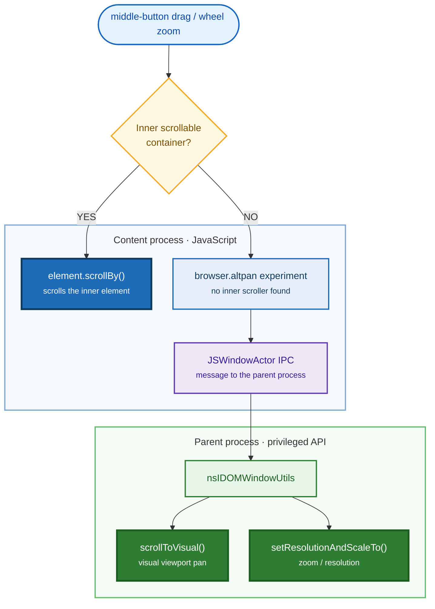

<p align="center">
  <a href="https://github.com/BeyondMagic/altpan">
    
  </a>
</p>

<h1 align="center">AltPan</h1>

<p align="center">
  <strong>
    A Firefox extension for middle-click drag panning and cursor-centered pinch-zoom across webpages.
  </strong>
</p>

<p align="center">
  <a href="https://github.com/BeyondMagic/altpan/blob/master/LICENSE"></a>
  
  
</p>

<p align="center">
  <strong>1:1 Hand-Tool Pan</strong>
  &middot;
  <strong>Pinch-Zoom Support</strong>
  &middot;
  <strong>No Native Daemon</strong>
  &middot;
  <strong>Kinetic Momentum</strong>
  &middot;
  <strong>Container Scrolling</strong>
  &middot;
  <strong>Domain Blacklist</strong>
</p>

## Purpose

Firefox supports pinch-zooming into a page, but panning around while zoomed in with a regular mouse does not work well. Standard autoscroll and `window.scrollBy` calls move only the page layout, so horizontal panning stops once the page fits within the window width.

AltPan provides a hand-tool drag gesture (middle-click drag by default) that moves the page on both axes at 1:1 speed while zoomed in, without requiring an external helper application or OS-level input bridge.

## Technical Architecture

AltPan runs as a self-contained Firefox WebExtension with a lightweight built-in Experiment API:



## Installation

Because AltPan uses `experiment_apis` for direct visual-viewport control, it requires **Firefox Nightly** or **Firefox Developer Edition** (standard Release Firefox rejects unsigned/custom WebExtension Experiments).

### Step 1: Enable Experiment APIs in Firefox

1. Open `about:config`.
2. Set `extensions.experiments.enabled` to `true`.
3. If installing the `.xpi` permanently outside temporary debugging, also set `xpinstall.signatures.required` to `false`.

### Step 2: Install the extension

#### Option 1: Permanent install

Copy `altpan.xpi` into your Firefox profile's `extensions/` directory:

```bash
cp altpan.xpi ~/.config/mozilla/firefox/<your-profile>/extensions/altpan@terra.local.xpi
```

You can also open `about:addons`, click the gear icon, pick "Install Add-on From File...", and select `altpan.xpi`.

#### Option 2: Temporary install (developer mode)

Open `about:debugging#/runtime/this-firefox`, click "Load Temporary Add-on...", and pick `manifest.json` from the repository folder.

## Configuration

Click the AltPan icon in your toolbar to change any setting:

| Setting | Default | Description |
| :--- | :--- | :--- |
| Enable AltPan | `true` | Turns AltPan on or off globally. |
| APZ Visual Viewport API | Live Status | Shows whether `browser.altpan` is active in Firefox. |
| Pan Modifier Key | `None` | Key held during drag: `None` (middle-click only), `Alt`, `Shift`, `Ctrl`, or `Meta`. |
| Pinch-Zoom Wheel | `Off` | Optional modifier+wheel zoom (`Off` keeps your native `about:config` mousewheel zoom untouched). |
| Sensitivity | `0.5x` | Drag speed multiplier (from `0.2x` to `2.5x`). |
| Kinetic Momentum | `Enabled` | Keeps scrolling briefly after you let go of the mouse button. |
| Coast Duration | `Normal` (`0.92`) | How fast momentum slows down (`Crisp`: `0.88`, `Normal`: `0.92`, `Floaty`: `0.96`). |
| Excluded Domains | `figma.com`, `miro.com`, `maps.google.com` | Sites where AltPan stays out of the way (plus a "+ Current Site" button). |
| Force Visual Pan | `false` | Routes drags via parent APZ widget (`sendNativeMouseScrollEvent`), independent of container scrollability. |
| Debug Logging | `false` | Logs frame, container, and scroll details to the webpage DevTools Console. |

___

# License

This project is licensed under [LGPLv3](./LICENSE).
