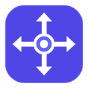
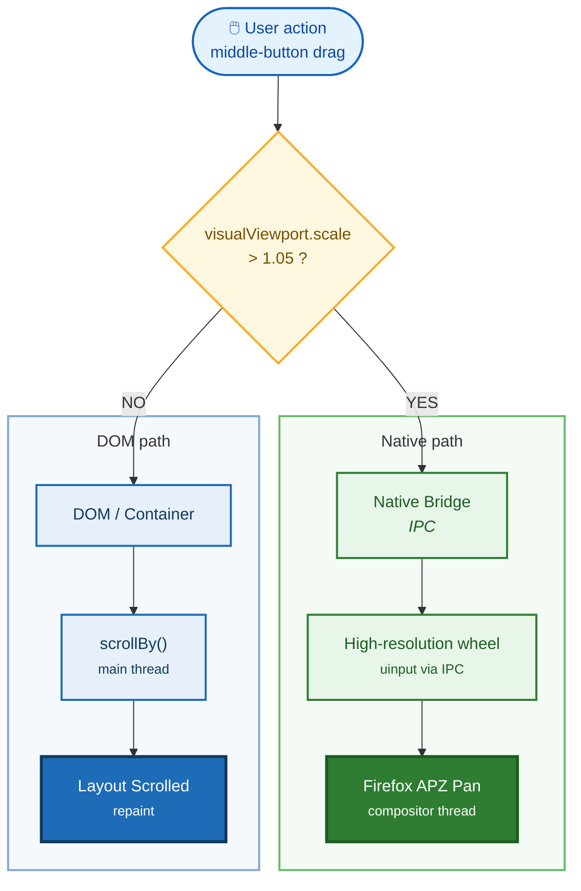

<p align="center">
  <a href="https://github.com/BeyondMagic/altpan">
    
  </a>
</p>

<h1 align="center">AltPan</h1>

<p align="center">
  <strong>
    A Firefox extension for middle-click drag panning across zoomed pages and viewports.
  </strong>
</p>

<p align="center">
  <a href="https://github.com/BeyondMagic/altpan/blob/master/LICENSE"></a>
  
  
</p>

<p align="center">
  <strong>1:1 Hand-Tool Pan</strong>
  &middot;
  <strong>Pinch-Zoom Support</strong>
  &middot;
  <strong>Linux uinput Bridge</strong>
  &middot;
  <strong>Kinetic Momentum</strong>
  &middot;
  <strong>Container Scrolling</strong>
  &middot;
  <strong>Domain Blacklist</strong>
</p>

## Purpose

If you pinch-zoom into a page in Firefox and try to pan around with a regular mouse, you quickly hit a wall. Standard autoscroll or `window.scrollBy` calls only move the DOM layout viewport. When a page doesn't overflow horizontally (`scrollWidth == clientWidth`), horizontal scrolling stays stuck at `0`, and `visualViewport.offsetLeft` is read-only.

AltPan gives you a hand-tool drag gesture (middle-click drag by default) that pans both axes at 1:1 speed, even while pinch-zoomed.

## Technical Architecture

AltPan picks between DOM scrolling and a native input helper depending on your current zoom level:



At normal zoom (`scale <= 1.05`), `content.js` scrolls the nearest scrollable parent container (like a code block or wide table) or falls back to `window.scrollBy`.

When pinch-zoomed (`scale > 1.05`), `content.js` batches mouse deltas on each `requestAnimationFrame` and sends them to `native/altpan_host.py` over Firefox's Native Messaging API. The Python helper writes high-resolution wheel events (`REL_HWHEEL_HI_RES` and `REL_WHEEL_HI_RES`) to `/dev/uinput`, which feeds directly into Firefox's Asynchronous Pan/Zoom (APZ) compositor. Firefox doesn't implement `browser.debugger`, so this local uinput bridge is how AltPan gets around the read-only visual viewport.

## Installation

You need both the Firefox extension and the Linux native helper (the helper is only needed if you want pinch-zoom panning).

### Step 1: Install the native helper (Linux)

Clone the repository and run the installer script:

```bash
git clone https://github.com/BeyondMagic/altpan.git
cd altpan
./install_host.sh
```

This writes the native host manifest to `~/.mozilla/native-messaging-hosts/` and `~/.config/mozilla/native-messaging-hosts/`, and marks `native/altpan_host.py` executable.

> [!NOTE]
> The helper writes to `/dev/uinput` using Python's `evdev` package. If your user account can't open `/dev/uinput`, add yourself to the `input` group and log back in:
> ```bash
> sudo usermod -aG input $USER
> ```

### Step 2: Install the extension in Firefox

#### Option 1: Permanent install

Copy `altpan.xpi` into your Firefox profile's `extensions/` directory:

```bash
cp altpan.xpi ~/.config/mozilla/firefox/<your-profile>/extensions/altpan@terra.local.xpi
```

You can also open `about:addons`, click the gear icon, pick "Install Add-on From File...", and select `altpan.xpi`.

#### Option 2: Temporary install (developer mode)

Open `about:debugging#/runtime/this-firefox`, click "Load Temporary Add-on...", and pick `manifest.json` from the repository folder.

## Configuration

Click the AltPan icon in your toolbar to change any setting:

| Setting | Default | Description |
| :--- | :--- | :--- |
| Enable AltPan | `true` | Turns AltPan on or off globally. |
| APZ Native Bridge | Live Status | Shows whether the `/dev/uinput` helper is connected. |
| Modifier Key | `None` | Key held during drag: `None` (middle-click only), `Alt`, `Shift`, `Ctrl`, or `Meta`. |
| Sensitivity | `0.5x` | Drag speed multiplier (from `0.2x` to `2.5x`). |
| Kinetic Momentum | `Enabled` | Keeps scrolling briefly after you let go of the mouse button. |
| Coast Duration | `Normal` (`0.92`) | How fast momentum slows down (`Crisp`: `0.88`, `Normal`: `0.92`, `Floaty`: `0.96`). |
| Excluded Domains | `figma.com`, `miro.com`, `maps.google.com` | Sites where AltPan stays out of the way (plus a "+ Current Site" button). |

___

# License

This project is licensed under [LGPLv3](./LICENSE).
